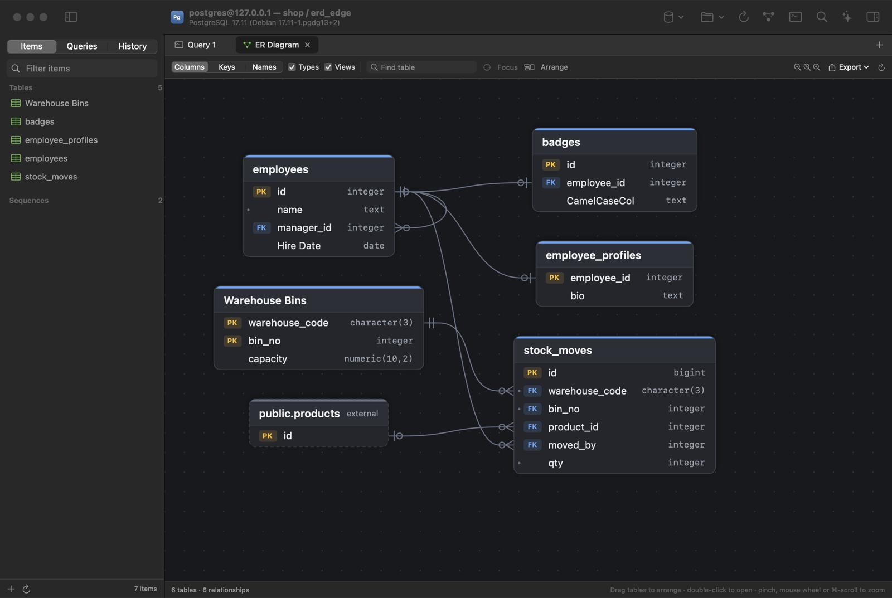

The first public release of **Tabula**: a fast, native macOS database client for PostgreSQL, MySQL/MariaDB, SQLite and Redis.



## Highlights

- **Databases:**
  - PostgreSQL, CockroachDB, Amazon Redshift and Greenplum (libpq).
  - MySQL, MariaDB and SingleStore (MariaDB Connector/C, including MySQL 8 authentication).
  - SQLite and Redis.
- **Connections:** SSL/TLS, SSH tunnels, environment colour tags, safe mode (confirm writes or read-only), and passwords stored in the Keychain.
- **Data grid:** smooth scrolling through large tables, inline editing, and a review of the generated SQL before you commit. Advanced filters, sorting and paging; jump to a foreign key with ⌥-click; copy as CSV, JSON, SQL or Markdown.
- **SQL editor:** syntax highlighting, context-aware autocomplete, formatter, multiple result sets, editable results, saved queries and history.
- **Structure editor and Create Table:** columns, indexes and foreign keys, with ALTER statements generated for each database.
- **ER diagrams (⇧⌘E):** crow's-foot notation, automatic layout, drag, zoom and focus. Export to PNG, PDF, SVG, Mermaid, DBML, PlantUML, Graphviz DOT, a Markdown data dictionary or SQL DDL.
- **Import and export:** CSV, JSON, SQL, Markdown and HTML, plus backup and restore through pg_dump, mysqldump and sqlite3.
- **Metrics dashboards:** charts and KPIs from your own SQL queries.
- **AI assistant (⌘J):**
  - Providers: Anthropic Claude, Azure AI Foundry (model deployments, Claude and Agents, with an API key or Microsoft Entra ID), OpenAI, OpenAI-compatible services and Ollama.
  - It sees your table and column definitions and the current query, never row data.

## Install

1. Download **Tabula-1.0.0-macOS-arm64.zip** below and unzip it.
2. Move **Tabula.app** to **Applications**.
3. The app isn't notarized by Apple, so the first time you open it, right-click (or Control-click) **Tabula.app** → **Open** → **Open**. If macOS still refuses, run this once in Terminal:

   ```bash
   xattr -dr com.apple.quarantine /Applications/Tabula.app
   ```

**Requirements:** macOS 14 Sonoma or later on Apple Silicon (M1 or newer).

The app is signed ad-hoc rather than with a Developer ID. Because of that, macOS may ask once for permission to read saved passwords from the Keychain; choose **Always Allow**.

To build it yourself instead, see [Build & install](https://github.com/Aoniq/tabula#build--install).

## License

Source-available under the [PolyForm Noncommercial License 1.0.0](https://github.com/Aoniq/tabula/blob/main/LICENSE): free for non-commercial use, but it may not be sold or used commercially without permission. The bundled libraries keep their own licenses; see [THIRD_PARTY_NOTICES.md](https://github.com/Aoniq/tabula/blob/main/THIRD_PARTY_NOTICES.md).
